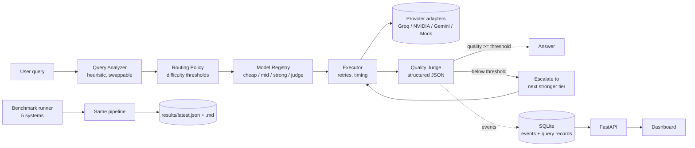

# SmartRouter

**Multi-LLM routing with answer verification, an LLM judge and bounded escalation, plus a benchmark that tests whether any of it pays off.**

SmartRouter picks a starting model tier (cheap / mid / strong) for each query with a keyword heuristic, checks the answer with deterministic checks and an independent LLM judge, and escalates to a stronger tier when the answer is not accepted. Every decision is logged, and a reproducible benchmark compares it against always-cheap, always-mid, always-strong and static-routing baselines on exactly checkable questions.

> Research hypothesis: *adaptive routing can reduce cost without reducing answer quality.* This is the question the project is built to test. **On the recorded real-model runs it is not supported**: the cheap model alone was as accurate as SmartRouter at about 1/7 of the cost. See [Results](#results).

---

## Results

Measured on the 30-item `hard` set (12 math, 9 reasoning, 9 coding; every item checked exactly), three complete real-model
runs with one lineup (cheap `openai/gpt-oss-20b`, mid `openai/gpt-oss-120b`, strong `nvidia/nemotron-3-ultra-550b-a55b`,
judge `gemini-3.5-flash-lite`), pooled. Re-scored with the current methodology by `python -m benchmark.reanalyze`
(full tables: [`benchmark/results/reanalysis.md`](benchmark/results/reanalysis.md)).

| System | Strict exact accuracy | 95% CI | Cost incl. judge | vs Always Cheap | Calls / query | Escalation |
|---|---|---|---|---|---|---|
| Always Cheap | 85/90 = 94.4% | 87.6–97.6% | 0.97 | 1.0x | 0.97 | – |
| Static Router | 86/90 = 95.6% | 89.1–98.3% | 2.70 | 2.8x | 0.99 | – |
| Always Strong | 86/90 = 95.6% | 89.1–98.3% | 9.89 | 10.2x | 0.99 | – |
| SmartRouter | 88/90 = 97.8% | 92.3–99.4% | 6.94 | 7.2x | 2.22 | 7.8% |

Paired on the same items, SmartRouter beat Always Cheap 5 times and lost 2 (sign test p = 0.45): **no detectable
accuracy difference**, at about 7x the cost once its own judge calls are counted (a lower bound: these older records did not
store judge parse retries; runs made now record every billed call). Calls below 1.00 are generation calls that failed. Of SmartRouter's 7 escalations, 6 were
*unnecessary* (the answer it replaced was already correct). Always Strong was not more accurate than Always Cheap either.

What this proves: the pipeline, verification and escalation machinery work end to end on real providers, and the
benchmark can tell when routing does **not** pay off. What it does not prove: that routing saves money at equal quality.
The `hard` set is saturated for this lineup (the cheap model already scores ~94%), and 30 items cannot detect small
differences. `benchmark/datasets/hard_v2.jsonl` (22 harder, generator-verified items) is the next experiment; whether it
separates the tiers is unknown until it is run. The earlier "68% cheaper than always-strong" figure was true but
misleading, because Always Cheap was cheaper still and just as accurate; reports now always compare against Always Cheap.

Pre-audit `benchmark/results/latest.json` was re-scored in place; mock runs are labeled synthetic everywhere and are never
used for a verdict.

---

## The problem

Sending every query to the strongest model is simple but wasteful. "What is the capital of Australia?" does not need the same model as "prove this algorithm is correct". Sending everything to the cheapest model has the opposite problem: hard queries get wrong answers. SmartRouter sits in between:

How one request flows (`app/core/pipeline.py`):

1. **Validate** (`app/main.py`, `app/schemas/common.py`): Host allow-list, body size cap while streaming, query length,
   invalid Unicode, at most `MAX_INFLIGHT_QUERIES` in flight (else 429), whole request under `REQUEST_DEADLINE_S` (else 504).
2. **Analyze** (`app/core/analyzer.py`): keyword regexes give a category and a difficulty score in [0, 1].
3. **Route** (`app/router/`): difficulty thresholds pick the starting tier.
4. **Generate** (`app/core/executor.py`): the provider call, with bounded retries on transient errors only. Every call,
   retries included, draws from a per-query budget (`MAX_PROVIDER_CALLS_PER_QUERY`, default 16).
5. **Verify** (`app/verification/`): checks that need no answer key, e.g. the Python parses and defines the requested
   function, a plain arithmetic answer is right, and (opt-in) the code reproduces its own examples.
6. **Judge** (`app/judge/`): an LLM from a different model family returns strict JSON scores; malformed output is retried
   once, then the fallback judge is tried, then the answer is marked unverified.
7. **Decide** (`app/core/escalation.py`, a pure function): a failed check escalates; a confident judge acceptance is
   accepted; a rejection or low-confidence acceptance gets a second opinion from another model.
8. **Escalate** to the next untried stronger tier, at most `MAX_ESCALATIONS` times. A judge outage never escalates.
9. **Log and return** (`app/logging/`): every step goes to SQLite; the answer comes back as `accepted`, `best_effort`
   (nothing was accepted; the best candidate is returned, never one that failed its own checks) or `failed`.

## Architecture



| Layer | Path | Responsibility |
|---|---|---|
| Providers | `app/providers/` | One `LLMProvider` interface; OpenAI-compatible (Groq, NVIDIA), Gemini and Mock adapters; typed errors; normalized `LLMResponse` |
| Registry | `app/models/` | Which model fills each role; metadata from `config/models.json`; startup validation |
| Analyzer | `app/core/analyzer.py` | Category and difficulty heuristics (replaceable by a learned model) |
| Router | `app/router/` | Threshold policy and escalation targets; no provider code |
| Executor | `app/core/executor.py` | Calls a provider, bounded retries with backoff and Retry-After, per-query call budget, latency timing |
| Judge | `app/judge/` | Prompt, robust JSON parsing, weighted `quality_score` |
| Pipeline | `app/core/pipeline.py` | The analyze → route → generate → judge → escalate loop |
| Logging | `app/logging/` | SQLite store: pipeline events and consolidated query records |
| Metrics | `app/core/metrics.py` | Shared by the dashboard API and the benchmark |
| API | `app/api/`, `app/main.py` | FastAPI endpoints; also serves the dashboard |
| Benchmark | `benchmark/` | Datasets, 5 systems, exact evaluators, paired statistics, report, re-analysis |
| Dashboard | `frontend/` | Vanilla HTML/CSS/JS with hand-drawn SVG charts |

## Routing and escalation

The initial tier comes from the analyzer's difficulty estimate (thresholds are configurable):

```
difficulty < 0.35         → cheap
0.35 <= difficulty < 0.70 → mid
difficulty >= 0.70        → strong
```

If the judge scores an answer below the threshold, or its verdict is `incorrect`/`irrelevant`, or the provider call fails, the pipeline escalates:

```
cheap ──accepted──▶ answer
  └── below threshold ──▶ mid ──accepted──▶ answer
                           └── below threshold ──▶ strong ──▶ answer (accepted or best_effort)
```

- Escalation stops at `strong` and never exceeds `MAX_ESCALATIONS`.
- A model that was already tried is skipped, even if two tiers share it.
- If nothing is accepted, the best candidate is returned with `final_status = "best_effort"` (answers that failed a deterministic check rank last, then by judge score). If no attempt produced an answer at all, the status is `failed`. Success is never fabricated.

**What the router actually does (measured, no model calls).** On all 152 dataset questions the difficulty score never
reaches 0.70, so the router never picks the strong tier: the "hard" keyword list fired on 1 question in 152, and short real
questions rarely contain several reasoning keywords. In practice the score is the category's base value, so routing is
"general knowledge → cheap, math / code / reasoning → mid". On the recorded `hard` runs the cheap model answered 74 of 78
of the questions the router sent to mid correctly (95%), so sending them to mid tripled their cost without measurable
benefit. The heuristic is kept on purpose: it is deterministic and explainable, and with ~5% cheap-model failures there is
too little failure data to train a better one. A routing policy only helps when the lineup has a real capability gap; that
is what `hard_v2` tests.

**Worst-case cost of one request.** Without a cap: 3 attempts × (4 generation tries + 2 judges × 2 parse tries × 4
transport tries + 2 second-opinion tries) = 66 provider calls. With the per-query budget the ceiling is
`MAX_PROVIDER_CALLS_PER_QUERY` (16), enforced before each network call and proven by a regression test. Calls the
benchmark makes for evaluation only (reference grading) are outside the request budget.

Every routing decision is logged with its reason, for example `{"event_type": "route_selected", "payload": {"category": "reasoning", "difficulty": 0.62, "selected_tier": "mid", "reason": "reasoning query, moderate estimated difficulty (0.35 <= 0.62 < 0.7)"}}`.

## Model registry: models are configuration

Model IDs and providers come from `.env` (`CHEAP_MODEL`, `CHEAP_PROVIDER`, …, `JUDGE_MODEL`). Per-role metadata such as capability score, normalized cost, expected latency, strengths and optional real pricing lives in `config/models.json`. Changing models is a config change, not a code change.

At startup, SmartRouter checks every configured model against the provider's model-listing API (`VALIDATE_MODELS=true`). An unknown model is a clear configuration error. **No model is ever silently substituted.**

## Quality judge and `quality_score`

The judge receives the query and the candidate answer. It is told not to reward verbosity and not to trust the candidate's own claims, and to classify the answer as `good`, `partially_correct`, `incorrect`, `incomplete` or `irrelevant`. It returns JSON with four dimension scores. SmartRouter then computes:

```
quality_score = 0.40·correctness + 0.25·completeness + 0.20·relevance + 0.15·reasoning_quality
```

Coding and math queries weight correctness more heavily (`CATEGORY_WEIGHTS` in `app/judge/judge.py`). The individual dimensions are always stored alongside the aggregate.

Judge output is parsed as strict JSON first, then as fenced or embedded JSON, and always schema-validated. A malformed response is retried once. After that it is recorded as a `JudgeParseError`, never as a pass. When the judge is unavailable (malformed output, quota, timeout) the pipeline does **not** escalate, because an outage says nothing about answer quality. It returns the answer as unverified `best_effort`, and benchmark reports are flagged as incomplete.

### Layered verification

The first real hard-set benchmark showed that a single judge verdict was the weak link: the judge rejected
correct math answers (it could not redo the arithmetic), so SmartRouter escalated to the strong model for
nothing, and it accepted code that did not even reproduce its own examples. Escalation is therefore decided
in layers (`app/core/escalation.py`, a pure function that always returns a written reason):

1. **Answer checks** (`app/verification/`) use only the question and the answer, never an answer key,
   so they are valid in production. Each check reports an evidence label:
   - *Code:* labeled Python must parse (`syntax_failed`); functions the question names in backticks must be
     defined and callable with the arguments shown (`function_missing`, `function_signature_mismatch`).
   - *Execution (opt-in, `VERIFY_EXECUTE_CODE=true`):* only blocks labeled Python are run, as `__main__`,
     so self-tests under `if __name__ == "__main__":` run too. A failing own assertion is `assertion_failed`
     (the answer contradicts itself), another crash is `module_execution_failed`, and a mismatching `>>>`
     example is `self_example_failed`. Missing context (`NameError`, missing imports, `input()`, files,
     network, timeouts, deliberate error demos) is `not_checkable`, never a failure. Code runs in a
     subprocess with no API keys in its *environment* and Python-level socket calls patched. **This is not a
     sandbox**: the code runs as your user, so it can read `.env` and any file you can, open raw sockets
     (`import _socket`), and spawn processes. Prompt text can steer what a model writes, so enable it only on a
     machine and with queries you trust (the app refuses it when `HOST` is not loopback). For anything else, run
     in a container or VM without secrets.
   - *Math:* only unambiguous shapes are verified: a question that is purely an arithmetic expression, "the
     remainder when A is divided by B", or "Solve for x: ..." (the answer's value is substituted back). Exact
     fractions, no `eval`. Word problems, percentages and combinatorics are not interpreted.
   A failed check (`fail`) escalates even if the judge accepted. `passed` is supporting evidence only and never
   overrides a judge; `not_checkable` has no effect.
2. **Primary judge** gives the quality score plus `judge_confidence`: how sure it is of its *own verdict*.
3. **Second opinion**: a rejection or a low-confidence acceptance (below `JUDGE_CONFIDENCE_MIN`) is sent to the
   other configured judge, which is a different model. SmartRouter escalates only if that judge also rejects. If
   no second opinion is available, the primary verdict stands, which was the old behavior.

Second opinions are **bounded**: an optional dedicated model (`SECOND_OPINION_PROVIDER/MODEL`), a
wall-clock budget for the whole call including retries (`SECOND_OPINION_TIMEOUT_S`, default 20 s), at most
`SECOND_OPINION_MAX_RETRIES` retries for transient errors, and no retry for empty or malformed output. Only
second-opinion calls get an extra "JSON only" instruction; the primary judge's prompt is unchanged. Each
invocation records its trigger, latency (successful or not) and provider calls.

Answer correctness, judge confidence, the escalation decision and the reported quality score (always the
primary judge's) are kept as separate fields on each attempt. The benchmark exact-checks *every* attempt, so
the report can separate necessary from unnecessary escalations and score each judge decision.

The benchmark's own exact checks (hidden expected answers and unit tests) are **never** used inside the
loop: that would leak the answer key and fabricate the result.

An optional **fallback judge** (`JUDGE_FALLBACK_PROVIDER` / `JUDGE_FALLBACK_MODEL`) takes over for a single answer when the primary judge fails after its retries. Every attempt records which judge graded it, and the benchmark report shows judge usage per system, because scores from two different judges are not perfectly comparable.

**`quality_score` is not a probability of correctness.** The judge is itself an LLM. It has evaluator bias, verbosity bias and errors correlated with the models it grades. It also makes its own reasoning mistakes and scores inconsistently. That is why the benchmark also uses reference answers and deterministic checks.

## Benchmark methodology

`benchmark/datasets/benchmark.jsonl` holds **100 fixed, hand-written items**: 20 each of `general_qa`, `reasoning`, `coding`, `math` and `summarization`, labeled easy, medium or hard. Each item has a reference answer. Math items (and a few numeric reasoning items) have an exact expected value. Function-style coding items ship with unit tests.

`benchmark/datasets/hard.jsonl` adds **30 hard items** (12 math, 9 reasoning, 9 coding), every one of them checked exactly: numeric answers computed in Python, and coding tasks with unit tests verified against a reference solution. The main set turned out too easy for current models, so every system tied; the hard set was meant to separate them, but the cheap model still scores ~94% on it (see Results). Run it with `--dataset hard --exec-code`.

`benchmark/datasets/hard_v2.jsonl` adds **22 harder items** (12 math, 5 reasoning, 5 coding with edge-case and performance
tests). Every expected value is computed by `benchmark/build_hard_v2.py`, and a test checks that the file matches the
generator and that every reference answer passes its own check. Run it with `--dataset hard_v2 --exec-code`.

The benchmark runs five systems. All of them run through **the same production pipeline**; only the mode differs:

| System | Mode | What it does |
|---|---|---|
| Always Cheap | `always_cheap` | Every query goes to the cheap tier (the baseline SmartRouter must beat) |
| Always Mid | `always_mid` | Every query goes to the mid tier |
| Always Strong | `always_strong` | Every query goes to the strong tier (quality ceiling / cost reference) |
| Static Router | `static` | Heuristic routing, no escalation |
| SmartRouter | `smart` | Heuristic routing plus answer checks and judge-driven escalation |

How answers are graded:

- **Primary metric: strict exact accuracy** = correct / every deterministically checkable item. Numeric answers must match
  exactly when the expected value is an integer (a relative tolerance used to accept 76120 for 76127); an answer with no
  readable final number counts as wrong instead of being dropped from the denominator. 95% Wilson intervals are reported.
- **Paired sign tests** compare systems item by item (SmartRouter vs Cheap / Mid / Strong). The report generates a claim
  verdict from them: *supported* only if SmartRouter is significantly more accurate than Always Cheap, cheaper than Always
  Strong including its judge calls, and not significantly less accurate than Always Strong.
- The **in-loop judge**, which drives escalation, never sees the reference answer. LLM-judge scores (with and without the
  reference) are reported as secondary signals only: the same judge family drives the escalations, so ranking systems by it
  would be circular.
- **Router validation**: the report shows how the heuristic analyzer's category and initial tier line up with the dataset's
  own labels (no model calls).
- With `--exec-code`, code answers are run against the item's tests in a subprocess with a timeout. This executes
  model-written code on your machine (see Security model).
- `python -m benchmark.reanalyze` re-scores every recorded real run in `data/benchmarks/` with the current methodology,
  pools runs that used the same model lineup, and refreshes `latest.json` / `latest.md`.

The metrics cover:

- quality: mean, median and per category
- normalized cost, with and without SmartRouter's serving-time judge calls
- utilization of each tier
- escalation rate
- latency: mean, median, p95, and generation-only
- the share of queries below the threshold, and the share that failed

**Normalized cost** is an experiment weight (cheap = 1, mid = 3, strong = 10, set in `config/models.json`). It is not money. It shows relative model usage. Real per-token pricing fields exist but are never mixed into it.

## Getting started

### Install

```bash
python -m venv .venv
```

Windows PowerShell:

```powershell
.venv\Scripts\Activate.ps1
```

macOS / Linux:

```bash
source .venv/bin/activate
```

Then:

```bash
pip install -r requirements.txt        # runtime
pip install -r requirements-dev.txt    # + pytest, ruff (needed to run the tests)
```

Requires Python 3.10+ (CI runs 3.10 and 3.13).

### Configure

```bash
cp .env.example .env
```

(PowerShell: `Copy-Item .env.example .env`)

`.env.example` ships with `MOCK_MODE=true`, so everything works offline with no keys. To use real models:

```env
MOCK_MODE=false
GROQ_API_KEY=...
GEMINI_API_KEY=...
NVIDIA_API_KEY=...        # only if a role uses PROVIDER=nvidia

CHEAP_PROVIDER=groq
CHEAP_MODEL=<current Groq model id>
MID_PROVIDER=groq
MID_MODEL=<current Groq model id>
STRONG_PROVIDER=groq
STRONG_MODEL=<current Groq model id>
JUDGE_PROVIDER=gemini
JUDGE_MODEL=<current Gemini model id>
```

Look up current model IDs from each provider's model list. Model catalogs change, so no IDs are hard-coded. Other settings are listed in `.env.example`: threshold, routing cut-offs, retries, timeouts, concurrency, request size limit and log paths. `.env` is git-ignored. API keys are sent only in request headers, and are redacted from logged error messages.

### Run the API and dashboard

```bash
python -m app.main
```

Then open http://127.0.0.1:8000. The dashboard is served by the same process, so there is nothing else to run.

| Method | Path | Purpose |
|---|---|---|
| GET | `/health` | Liveness and mock-mode flag |
| POST | `/api/query` | `{"query": "..."}` → answer, routes, quality, trace |
| GET | `/api/query/{query_id}` | Full consolidated record |
| GET | `/api/stats` | Aggregate live-traffic metrics |
| GET | `/api/routes` | Recent routing decisions |
| GET | `/api/failures` | Failures grouped by cause |
| GET | `/api/benchmarks/latest` | Latest benchmark summary, or `not_evaluated` |
| GET | `/api/models` | Configured registry and thresholds |

### Run the benchmark

```bash
python -m benchmark.run
```

The next experiment (the one that can actually test the claim, because `hard` is saturated):

```bash
python -m benchmark.run --dataset hard_v2 --exec-code --no-reference-eval --delay 2
```

It runs all five systems on 22 items (about 110 queries, roughly 200–300 provider calls) and writes
`benchmark/results/latest.json` / `latest.md` plus raw per-item results in `data/benchmarks/<run_id>/`. The strong model
can take well over a minute per answer, so raise the per-call timeout for this run, otherwise timeouts count as wrong
answers for Always Strong (PowerShell: `$env:REQUEST_TIMEOUT_S="180"`; bash: `REQUEST_TIMEOUT_S=180 python -m ...`).
The command prints a warning and the report shows a banner if any generation or judge call failed; re-run rather than
quote such a run.

Useful flags:

- `--per-category 4`: a quick subset
- `--systems smart_router always_strong`: run only some systems
- `--concurrency 1`: the default, sequential mode for free tiers
- `--delay 2`: pause between queries to stay under rate limits
- `--exec-code`: run code tests
- `--no-reference-eval`: save judge calls

To regenerate the Markdown from the latest JSON, or to re-score every recorded real run with the current methodology:

```bash
python -m benchmark.report
python -m benchmark.reanalyze
```

A full run on the 100-item set makes about 500+ generation calls and 1000+ judge calls (five systems). Each system's answers are judged in-loop, and then a reference-graded pass judges them again; `--no-reference-eval` roughly halves the judge calls. Check your provider quotas first.

### Run the tests

```bash
pytest
ruff check .
```

The tests use mocked providers and HTTP transports, so they need no API keys or network access.

## Logs and storage

Everything is stored in one SQLite file, `data/logs/smartrouter.db` (stdlib `sqlite3`, WAL mode, no server):

- `events`: one row per pipeline event (`query_received`, `query_analyzed`, `route_selected`, `generation_*`,
  `provider_error`, `checks_completed`, `checks_error`, `judge_*`, `second_opinion_*`, `escalation_triggered`,
  `pipeline_completed`, `pipeline_failed`), indexed by query and type.
- `queries`: one consolidated record per query (every attempt with model, tier, latency, tokens, checks, judge dimensions,
  verdict, decision reason, plus totals and `provider_calls`).
- Benchmark runs write their own database plus per-system `<system>.jsonl` result files under `data/benchmarks/<run_id>/`.

Why SQLite and not JSONL any more: with JSONL a single truncated line (crash or full disk mid-write) made `/api/stats`,
`/api/routes` and `/api/failures` fail with HTTP 500 until the file was hand-edited, and every dashboard call re-parsed the
whole file. SQLite writes are transactional and reads are indexed; Postgres would add a server for no benefit at this scale.
A storage failure is logged and counted (`/health` reports `degraded`) but never turns a paid-for answer into an HTTP 500.
Older `*.jsonl` logs are not imported. There is no automatic retention: delete old rows with
`sqlite3 data/logs/smartrouter.db "DELETE FROM queries WHERE timestamp < '2026-01-01'"` (and the same for `events`).

## Design notes and deviations

- **Metrics live in `app/core/metrics.py`**, not `benchmark/metrics.py`, because the dashboard API computes the same statistics from live traffic.
- **The four baselines are rows in `benchmark/runners.py`** instead of four near-identical files. Each is just a pipeline mode.
- **The judge's cost is counted separately.** `normalized_cost` covers generation calls only. The benchmark reports "cost incl. judge" for SmartRouter, the only system that needs the judge at serving time.
- **Latency is real `perf_counter` time**, including retries and backoff. Mock mode does not sleep, so mock latencies are near zero; they are measured, not invented.
- **Mock mode.** Synthetic quality is `capability + 0.35 − 0.6·difficulty ± jitter`, derived deterministically from a hash. This makes escalation happen so the full system can be exercised offline. It is not a model of real LLM behavior.
- **Live-traffic "cost reduction"** on the dashboard is measured against a counterfactual where every query uses the strong tier, computed from the configured weights. Only the benchmark measures a real baseline.

## Security model

SmartRouter is a **local, single-user tool**, not a hardened public service. Authentication is deliberately not
implemented: the deployment boundary is one user on loopback.

- **No authentication, per-user rate limiting or TLS.** Anyone who can reach the port can spend your provider quota and read
  every logged query via `/api/routes`, `/api/failures` and `/api/query/{id}`. Keep `HOST=127.0.0.1` (the default); the app
  warns on any other host. Put it behind an authenticating reverse proxy before exposing it.
- **DNS rebinding** is blocked by a Host-header allow-list (`ALLOWED_HOSTS`, loopback names by default), so a web page cannot
  re-point its domain at 127.0.0.1 and call the API as "same origin". Cross-site form posts cannot send a JSON body.
- **Cost and abuse limits**: request bodies are capped while streaming (HTTP 413), `MAX_QUERY_CHARS`, `MAX_INFLIGHT_QUERIES`
  (HTTP 429), `REQUEST_DEADLINE_S` (HTTP 504) and `MAX_PROVIDER_CALLS_PER_QUERY` (default 16). Before the call budget, one query
  could make up to 66 provider calls (3 attempts x [4 generation tries + 2 judges x 2 parse tries x 4 transport tries + 2
  second-opinion tries]); a probe reproduced 42. Keyword-stuffed queries can still force the strong tier (accepted risk:
  bounded by the budget).
- **Errors** return a generic 500 body; exception text stays in the server log. API keys travel only in headers and are
  redacted from logged errors (a test greps the database files for the key).
- **Code execution** (`VERIFY_EXECUTE_CODE`, benchmark `--exec-code`) is off by default and refused on a non-loopback host.
  **It is not a sandbox.** Exactly what exists (`app/verification/checks.py`, `run_isolated`):

  | Aspect | Behavior |
  |---|---|
  | Process | fresh `python -I` (isolated mode), cwd = a throwaway temp directory, stdin closed |
  | Environment | only PATH / TEMP / SYSTEMROOT-style variables; no API keys |
  | Filesystem | **full access as your user**: it can read `.env`, your files, and write anywhere you can |
  | Network | `socket.socket` / `create_connection` / `getaddrinfo` patched in Python; **`import _socket` bypasses it** |
  | Timeout | `CODE_CHECK_TIMEOUT_S` (10 s); Linux/macOS kill the whole process group; **Windows kills only the direct child** |
  | Limits (Linux) | 1 GiB address space, 10 MB per file, process-count cap, no core dumps (macOS enforces some of these; Windows none) |
  | Its report | parsed as untrusted; a forged or broken report is "not checkable", never a crash |

  A real boundary would be a container or VM per run: no secrets mounted, read-only root filesystem, no network
  namespace, a non-root user, seccomp, CPU/memory/pid cgroup limits and a wall-clock kill (e.g. Docker with
  `--network none --read-only --memory --pids-limit`, or gVisor / Firecracker). Prompt text can steer what a model writes,
  so only enable execution for your own queries.
- Queries and answers are stored unredacted in `data/logs/smartrouter.db`, with no automatic retention.
- The judge prompt wraps untrusted text in delimiters and neutralizes attempts to close them (including `< /candidate>`
  spacing tricks), but a model's answer can still persuade an LLM judge. Judge scores are a signal, not a security control.

## Limitations

- **The LLM judge is not ground truth.** Scores are a noisy evaluation signal and can be biased toward longer answers or toward models similar to the judge.
- **Ground truth is partial.** Only numeric and unit-tested items have deterministic checks. Open-ended answers rely on the judge plus a short reference.
- **The benchmark is small and saturated.** 30 hard items give wide confidence intervals, and the cheap model already scores ~94% on them, so there is little room for routing to help. Re-running the same items measures run-to-run variance, not new samples.
- **Rate limits.** Free tiers throttle aggressively. Retries honor `Retry-After`, but runs can be slow, and errors are recorded as failures.
- **Provider models change.** Results apply only to the model IDs and date in a report.
- **Normalized cost is an experimental metric**, not a bill.
- **Second opinions cost latency and judge calls**, and a lenient second judge can let a wrong answer through.
  The self-example check only helps when an answer shows examples; a confident wrong acceptance with no
  contradicting evidence is still accepted.
- **Mixed judges.** When the fallback judge is used, some answers are graded by a different model; compare judge usage before comparing quality.
- **Tier order is an assumption until measured.** The report's *Accuracy by answering tier* table checks it; an early lineup had a "mid" model less accurate than the "cheap" one, which made routing upward counter-productive.
- **The analyzer is a keyword heuristic, and it barely tracks difficulty.** On the 130 labeled items it gets the category right 76% of the time, sends *no* item to the strong tier, and routes 18 of the 66 items labeled "hard" to the cheap tier. Keyword stuffing ("prove rigorously, design an architecture…") forces an expensive tier; a hard question without keywords goes to cheap. Escalation only corrects under-routing, never over-routing.
- **Most escalations were unnecessary** in the recorded runs (6 of 7): the judge rejected correct answers more often than it caught wrong ones.
- **Storage is a single local SQLite file**: fine for one process; not shared across several API workers.

## Extending

The codebase has clean extension points for later work:

- **Learned or bandit routing**: implement `RoutingPolicy.select(analysis, registry, history)`.
- **A learned analyzer**: implement `QueryAnalyzer.analyze(query)`.
- **More providers**: an OpenAI-compatible API is one row in `OPENAI_COMPATIBLE` in `app/providers/factory.py`; anything else subclasses `HTTPProvider`.
- **Data-driven routing (V2)**: the consolidated query records already pair query features with the model chosen, its observed quality and whether it escalated. That is the training data for estimating `P(model succeeds | query)`.

## License

MIT. See [LICENSE](LICENSE).
