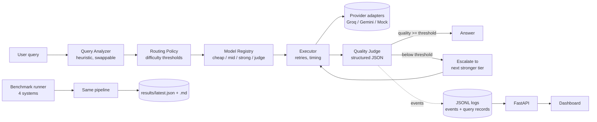

# SmartRouter

**Adaptive multi-LLM routing with a self-healing quality loop.**

SmartRouter decides *which* model should answer each query. It sends easy queries to a cheap model and hard ones to a stronger model. An independent LLM judge scores every answer, and a weak answer is escalated to the next stronger tier. Every decision is logged, and a reproducible benchmark measures what the routing actually buys you against three baselines.

> Research hypothesis: *adaptive routing can reduce strong-model utilization while keeping answer quality comparable.* This is the question the project is built to test. It is **not** a claim; see [Results](#results).

---

## The problem

Sending every query to the strongest model is simple but wasteful. "What is the capital of Australia?" does not need the same model as "prove this algorithm is correct". Sending everything to the cheapest model has the opposite problem: hard queries get wrong answers. SmartRouter sits in between:

1. **Analyze** the query (category, difficulty).
2. **Route** it to the cheapest tier expected to handle it.
3. **Generate** an answer.
4. **Judge** the answer with an independent model.
5. **Accept** it if `quality_score >= QUALITY_THRESHOLD`, otherwise **escalate** to a stronger tier.
6. **Log** every step and return the best answer, marked honestly as `accepted`, `best_effort` or `failed`.

## Architecture



| Layer | Path | Responsibility |
|---|---|---|
| Providers | `app/providers/` | One `LLMProvider` interface; Groq, Gemini and Mock adapters; typed errors; normalized `LLMResponse` |
| Registry | `app/models/` | Which model fills each role; metadata from `config/models.json`; startup validation |
| Analyzer | `app/core/analyzer.py` | Category and difficulty heuristics (replaceable by a learned model) |
| Router | `app/router/` | Threshold policy and escalation targets; no provider code |
| Executor | `app/core/executor.py` | Calls a provider, bounded retries with backoff and Retry-After, latency timing |
| Judge | `app/judge/` | Prompt, robust JSON parsing, weighted `quality_score` |
| Pipeline | `app/core/pipeline.py` | The analyze → route → generate → judge → escalate loop |
| Logging | `app/logging/` | Append-only `events.jsonl` and consolidated `queries.jsonl` |
| Metrics | `app/core/metrics.py` | Shared by the dashboard API and the benchmark |
| API | `app/api/`, `app/main.py` | FastAPI endpoints; also serves the dashboard |
| Benchmark | `benchmark/` | Dataset, 4 systems, deterministic evaluators, report |
| Dashboard | `frontend/` | Vanilla HTML/CSS/JS with hand-drawn SVG charts |

## Routing and escalation

The initial tier comes from the analyzer's difficulty estimate (thresholds are configurable):

```
difficulty < 0.35         → cheap
0.35 <= difficulty < 0.70 → mid
difficulty >= 0.70        → strong
```

If the judge scores an answer below the threshold, or its verdict is `incorrect`/`irrelevant`, or the provider call fails, the pipeline escalates:

```
cheap ──accepted──▶ answer
  └── below threshold ──▶ mid ──accepted──▶ answer
                           └── below threshold ──▶ strong ──▶ answer (accepted or best_effort)
```

- Escalation stops at `strong` and never exceeds `MAX_ESCALATIONS`.
- A model that was already tried is skipped, even if two tiers share it.
- If nothing meets the threshold, the highest-scoring candidate is returned with `final_status = "best_effort"`. If no attempt produced an answer at all, the status is `failed`. Success is never fabricated.

Every routing decision is logged with its reason, for example `{"event_type": "route_selected", "payload": {"category": "reasoning", "difficulty": 0.62, "selected_tier": "mid", "reason": "reasoning query, moderate estimated difficulty (0.35 <= 0.62 < 0.7)"}}`.

## Model registry: models are configuration

Model IDs and providers come from `.env` (`CHEAP_MODEL`, `CHEAP_PROVIDER`, …, `JUDGE_MODEL`). Per-role metadata such as capability score, normalized cost, expected latency, strengths and optional real pricing lives in `config/models.json`. Changing models is a config change, not a code change.

At startup, SmartRouter checks every configured model against the provider's model-listing API (`VALIDATE_MODELS=true`). An unknown model is a clear configuration error. **No model is ever silently substituted.**

## Quality judge and `quality_score`

The judge receives the query and the candidate answer. It is told not to reward verbosity and not to trust the candidate's own claims, and to classify the answer as `good`, `partially_correct`, `incorrect`, `incomplete` or `irrelevant`. It returns JSON with four dimension scores. SmartRouter then computes:

```
quality_score = 0.40·correctness + 0.25·completeness + 0.20·relevance + 0.15·reasoning_quality
```

Coding and math queries weight correctness more heavily (`CATEGORY_WEIGHTS` in `app/judge/judge.py`). The individual dimensions are always stored alongside the aggregate.

Judge output is parsed as strict JSON first, then as fenced or embedded JSON, and always schema-validated. A malformed response is retried once. After that it is recorded as a `JudgeParseError`, never as a pass. When the judge is unavailable (malformed output, quota, timeout) the pipeline does **not** escalate, because an outage says nothing about answer quality. It returns the answer as unverified `best_effort`, and benchmark reports are flagged as incomplete.

**`quality_score` is not a probability of correctness.** The judge is itself an LLM. It has evaluator bias, verbosity bias and errors correlated with the models it grades. It also makes its own reasoning mistakes and scores inconsistently. That is why the benchmark also uses reference answers and deterministic checks.

## Benchmark methodology

`benchmark/datasets/benchmark.jsonl` holds **100 fixed, hand-written items**: 20 each of `general_qa`, `reasoning`, `coding`, `math` and `summarization`, labeled easy, medium or hard. Each item has a reference answer. Math items (and a few numeric reasoning items) have an exact expected value. Function-style coding items ship with unit tests.

The benchmark runs four systems. All of them run through **the same production pipeline**; only the mode differs:

| System | Mode | What it does |
|---|---|---|
| A. Always Weak | `always_cheap` | Every query goes to the cheap tier |
| B. Always Strong | `always_strong` | Every query goes to the strong tier (quality/cost reference) |
| C. Static Router | `static` | Heuristic routing, no escalation |
| D. SmartRouter | `smart` | Heuristic routing plus judge-driven escalation |

How answers are graded:

- The **in-loop judge**, which drives escalation, never sees the reference answer. This keeps it realistic for production.
- Every system's final answer is graded again by the judge **with** the reference answer. This *reference-graded quality* is the primary quality metric.
- **Deterministic checks**: numeric answers are compared to the expected value. With `--exec-code`, code answers are run against the item's tests in a subprocess with a timeout. Note that `--exec-code` executes model-written code on your machine.

The metrics cover:

- quality: mean, median and per category
- normalized cost, with and without SmartRouter's serving-time judge calls
- utilization of each tier
- escalation rate
- latency: mean, median, p95, and generation-only
- the share of queries below the threshold, and the share that failed

**Normalized cost** is an experiment weight (cheap = 1, mid = 3, strong = 10, set in `config/models.json`). It is not money. It shows relative model usage. Real per-token pricing fields exist but are never mixed into it.

## Results

Run the benchmark to generate current results.

No measured results are published here yet. `python -m benchmark.run` writes `benchmark/results/latest.json` and `benchmark/results/latest.md`, and the dashboard shows them. Runs in `MOCK_MODE` are labeled synthetic everywhere and must not be quoted as model results.

## Getting started

### Install

```bash
python -m venv .venv
```

Windows PowerShell:

```powershell
.venv\Scripts\Activate.ps1
```

macOS / Linux:

```bash
source .venv/bin/activate
```

Then:

```bash
pip install -r requirements.txt
```

Requires Python 3.11+.

### Configure

```bash
cp .env.example .env
```

(PowerShell: `Copy-Item .env.example .env`)

`.env.example` ships with `MOCK_MODE=true`, so everything works offline with no keys. To use real models:

```env
MOCK_MODE=false
GROQ_API_KEY=...
GEMINI_API_KEY=...

CHEAP_PROVIDER=groq
CHEAP_MODEL=<current Groq model id>
MID_PROVIDER=groq
MID_MODEL=<current Groq model id>
STRONG_PROVIDER=groq
STRONG_MODEL=<current Groq model id>
JUDGE_PROVIDER=gemini
JUDGE_MODEL=<current Gemini model id>
```

Look up current model IDs from each provider's model list. Model catalogs change, so no IDs are hard-coded. Other settings are listed in `.env.example`: threshold, routing cut-offs, retries, timeouts, concurrency, request size limit and log paths. `.env` is git-ignored. API keys are sent only in request headers, and are redacted from logged error messages.

### Run the API and dashboard

```bash
python -m app.main
```

Then open http://127.0.0.1:8000. The dashboard is served by the same process, so there is nothing else to run.

| Method | Path | Purpose |
|---|---|---|
| GET | `/health` | Liveness and mock-mode flag |
| POST | `/api/query` | `{"query": "..."}` → answer, routes, quality, trace |
| GET | `/api/query/{query_id}` | Full consolidated record |
| GET | `/api/stats` | Aggregate live-traffic metrics |
| GET | `/api/routes` | Recent routing decisions |
| GET | `/api/failures` | Failures grouped by cause |
| GET | `/api/benchmarks/latest` | Latest benchmark summary, or `not_evaluated` |
| GET | `/api/models` | Configured registry and thresholds |

### Run the benchmark

```bash
python -m benchmark.run
```

Useful flags:

- `--per-category 4`: a quick subset
- `--systems smart_router always_strong`: run only some systems
- `--concurrency 1`: the default, sequential mode for free tiers
- `--delay 2`: pause between queries to stay under rate limits
- `--exec-code`: run code tests
- `--no-reference-eval`: save judge calls

To regenerate the Markdown from the latest JSON:

```bash
python -m benchmark.report
```

A full run makes about 400+ generation calls and 800+ judge calls. Each system's answers are judged in-loop, and then a reference-graded pass judges them again; `--no-reference-eval` roughly halves the judge calls. Check your provider quotas first.

### Run the tests

```bash
pytest
```

The tests use mocked providers and HTTP transports, so they need no API keys or network access.

## Logs

- `data/logs/events.jsonl`: one line per event (`query_received`, `query_analyzed`, `route_selected`, `generation_started`, `generation_completed`, `generation_failed`, `provider_error`, `judge_completed`, `judge_failed`, `escalation_triggered`, `pipeline_completed`, `pipeline_failed`), each with `timestamp`, `query_id`, `event_type` and `payload`.
- `data/logs/queries.jsonl`: one consolidated record per query. It holds every attempt with model, tier, latency, tokens, dimension scores, verdict and failure reasons, plus totals.
- Benchmark runs log to `data/benchmarks/<run_id>/` so they don't mix with live traffic.

## Design notes and deviations

- **Metrics live in `app/core/metrics.py`**, not `benchmark/metrics.py`, because the dashboard API computes the same statistics from live traffic.
- **The four baselines are rows in `benchmark/runners.py`** instead of four near-identical files. Each is just a pipeline mode.
- **The judge's cost is counted separately.** `normalized_cost` covers generation calls only. The benchmark reports "cost incl. judge" for SmartRouter, the only system that needs the judge at serving time.
- **Latency is real `perf_counter` time**, including retries and backoff. Mock mode does not sleep, so mock latencies are near zero; they are measured, not invented.
- **Mock mode.** Synthetic quality is `capability + 0.35 − 0.6·difficulty ± jitter`, derived deterministically from a hash. This makes escalation happen so the full system can be exercised offline. It is not a model of real LLM behavior.
- **Live-traffic "cost reduction"** on the dashboard is measured against a counterfactual where every query uses the strong tier, computed from the configured weights. Only the benchmark measures a real baseline.

## Limitations

- **The LLM judge is not ground truth.** Scores are a noisy evaluation signal and can be biased toward longer answers or toward models similar to the judge.
- **Ground truth is partial.** Only numeric and unit-tested items have deterministic checks. Open-ended answers rely on the judge plus a short reference.
- **The benchmark is small.** 100 items can't resolve small quality differences, and no confidence intervals are computed.
- **Rate limits.** Free tiers throttle aggressively. Retries honor `Retry-After`, but runs can be slow, and errors are recorded as failures.
- **Provider models change.** Results apply only to the model IDs and date in a report.
- **Normalized cost is an experimental metric**, not a bill.
- **The analyzer is a keyword heuristic.** Its difficulty estimates are unvalidated, and misrouting is expected; that is part of what the benchmark measures.
- **Storage is JSONL** with full-file scans, which is fine for thousands of records but not millions.

## Extending

The codebase has clean extension points for later work:

- **Learned or bandit routing**: implement `RoutingPolicy.select(analysis, registry, history)`.
- **A learned analyzer**: implement `QueryAnalyzer.analyze(query)`.
- **More providers**: subclass `HTTPProvider` and register it in `app/providers/factory.py`.
- **Data-driven routing (V2)**: the consolidated query records already pair query features with the model chosen, its observed quality and whether it escalated. That is the training data for estimating `P(model succeeds | query)`.

## License

MIT. See [LICENSE](LICENSE).
